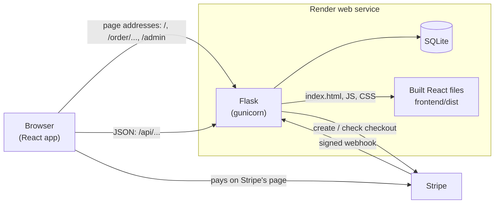
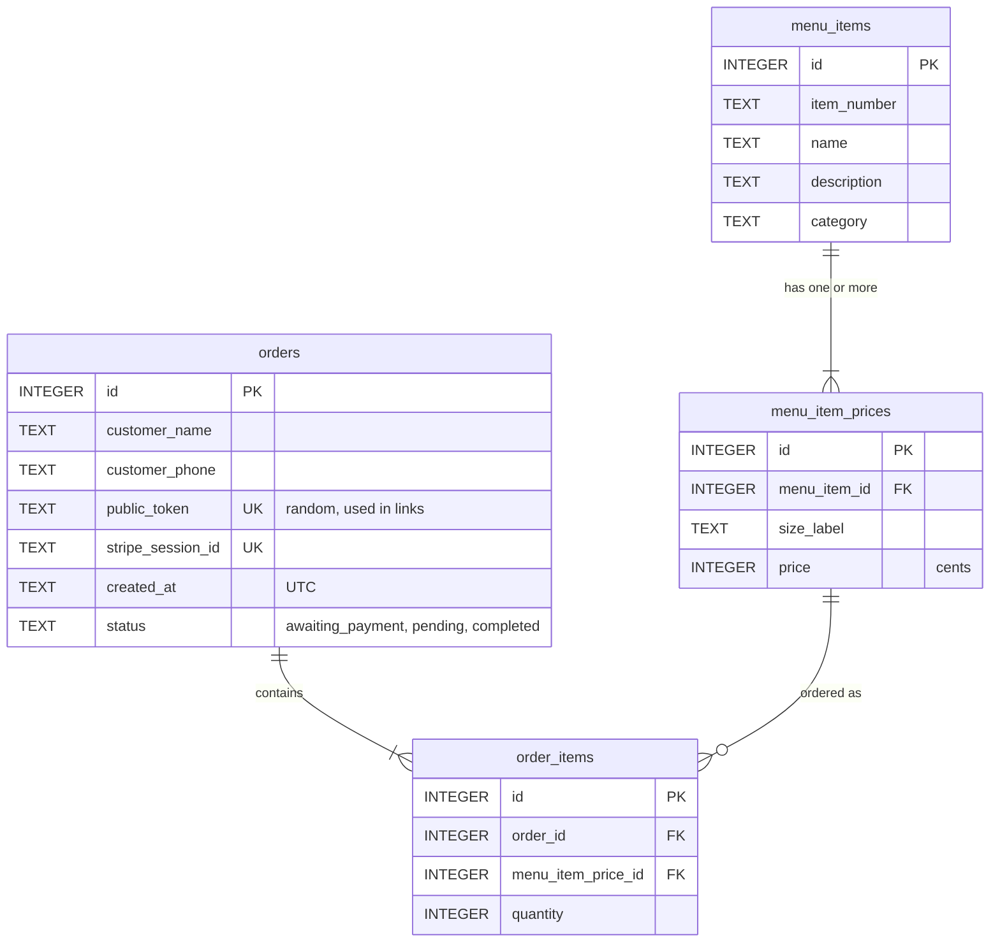
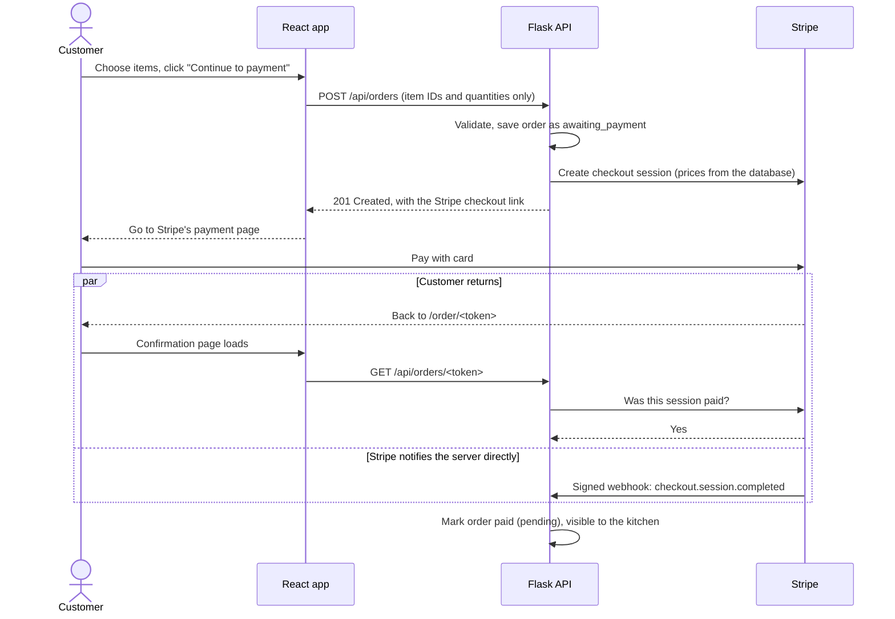

# China Chef — Online Ordering Menu System

A full-stack ordering site for my family's restaurant. The structure includes customers browsing a database-driven menu, placing orders, and paying through Stripe, and staff managing incoming orders from a password-protected admin dashboard. The frontend is a React single-page app talking to a Flask REST API.

**Live demo:** https://china-chef-demo.onrender.com/

> This is a portfolio project modeled on my family's restaurant. Orders placed on the demo are **not** sent to the restaurant. Payments run in Stripe's test mode, so no real money is charged: pay with the test card `4242 4242 4242 4242`, any future expiration date, and any CVC. The demo runs on a free hosting tier, so the first visit after a period of inactivity can take up to a minute to load.

## Features

- **Menu from a database.** Items, descriptions, and prices are stored in SQLite and served as JSON. Items can have a single price or several sizes (Small / Large / Extra Large).
- **Online ordering.** Customers choose quantities for any item or size and see a live order summary and running total as they go, then enter their name and phone number.
- **Online payment.** Checkout runs through Stripe's hosted payment page, so card details never touch this server. An order only reaches the kitchen once Stripe confirms it was paid. If a customer leaves the payment page early, their confirmation page offers a link back to finish paying, and if a payment is still processing, the page re-checks on its own.
- **Admin dashboard.** Staff log in with a username and password to see paid, pending orders (oldest first, like a kitchen queue) and recently completed ones, with times shown in the restaurant's local time. Orders are marked complete with one click, new orders appear automatically every 30 seconds, and there's a logout button.
- **Input validation and friendly errors.** Every value is rechecked on the server, and problems come back as clear messages instead of crashes.
- **Responsive layout.** Works on phones as well as desktops.

## Tech stack

| Layer | Technology |
|---|---|
| Frontend | React 19 (JavaScript), React Router, Vite |
| Backend | Python, Flask, as a JSON REST API ([API reference](API.md)) |
| Database | SQLite, accessed with raw SQL through Python's `sqlite3` module (no ORM) |
| Payments | Stripe Checkout (test mode) and Stripe webhooks |
| Auth | Session login with a signed, `HttpOnly` cookie |
| Testing | pytest |
| Deployment | Render, served by gunicorn |

## Architecture



- **One service, one address.** Flask serves both the API (`/api/...`) and the built React app. Any page address returns `index.html`, and React Router shows the right page. Because the browser only ever talks to one address, no cross-origin (CORS) setup is needed, and the login cookie works without special handling.
- **During development**, Vite serves the React app with instant reloading at `localhost:5173` and passes `/api/...` requests on to Flask, so it behaves like production.
- The full list of endpoints, request and response formats, and status codes is in **[API.md](API.md)**.

## Database schema



- `menu_item_prices` is separate from `menu_items` because items have different numbers of sizes (one price, Small/Large, or Small/Large/Extra Large). Each size is just another row.
- `order_items` is a junction table resolving the many-to-many relationship between orders and the specific item-and-size that was ordered.
- An order's `status` moves from `awaiting_payment` to `pending` (paid, waiting for the kitchen) to `completed`. A `CHECK` constraint rejects any other value.

## How payment works



Payment is confirmed two independent ways. Whichever arrives first marks the order paid, and the other changes nothing. The webhook covers customers who close the tab before being sent back.

## Technical highlights

- **SQL injection prevention.** Every query that includes user input uses parameterized `?` placeholders, so input is always treated as data and never as SQL. Tested by submitting a name containing `DROP TABLE`, where it was stored as plain text.
- **Money stored as integer cents, end to end.** Prices are integers (`375` = $3.75) in the database, the API, and Stripe, so totals never suffer floating-point rounding errors. They're converted to dollars only at the moment React displays them.
- **The server never trusts the browser.** Orders contain only item IDs and quantities; the server looks up prices itself, so prices can't be tampered with. Every field is type-checked (for example, JSON `true` is rejected as a quantity even though Python treats it as `1`), and foreign key constraints reject nonexistent items.
- **Orders saved in a single transaction.** An order and all its line items are written together; if any part fails, nothing is saved.
- **Payment is verified with Stripe, never assumed.** Opening a confirmation link proves nothing, since anyone can open a link, so the server asks Stripe directly whether the checkout was paid.
- **Signed webhooks.** The webhook rejects any message without a valid Stripe signature (an HMAC of the message and its timestamp), so forged, edited, or replayed messages are refused. Repeated deliveries are harmless because marking an order paid only changes orders that are still unpaid.
- **Test mode only.** The app only accepts Stripe test keys (`sk_test_...`). With a missing or live key, ordering is switched off, so the demo can never charge a real card.
- **Unguessable order links.** Confirmation pages are addressed by a random 128-bit token (`/order/k3J9x...`) rather than the order number, so customers can't view each other's orders by changing a number in the URL.
- **Admin sessions done safely.** The login cookie is signed with a secret key (so it can't be forged), `HttpOnly` (page scripts can't read it), `SameSite=Lax`, and HTTPS-only in production, and it expires after 12 hours. Wrong usernames and wrong passwords get the same message, credentials are compared in constant time, and the admin area turns itself off if its secrets aren't configured.
- **Cross-site request protection.** Login, logout, and "mark complete" reject requests whose `Origin` shows they came from another website.
- **Timestamps in UTC,** converted to Central time only in the browser.
- **Efficient caching.** Built JavaScript and CSS files carry a fingerprint in their names, so browsers cache them for a year, while the page itself is re-checked on every visit so new deploys show up immediately.

## Running locally

Requires Python 3.9 or newer and Node.js 22.22 or newer.

```bash
git clone https://github.com/ericwei2235/restaurant-menu-system.git
cd restaurant-menu-system

python -m venv venv
# Windows (PowerShell):
.\venv\Scripts\Activate.ps1
# macOS / Linux:
source venv/bin/activate

pip install -r requirements.txt
python init_db.py          # creates restaurant.db from schema.sql and seed.sql

npm --prefix frontend install
```

Set the secrets Flask needs: an admin password, a long random secret key for the login cookie, and a Stripe **test** secret key (from your Stripe dashboard in test mode, under Developers → API keys).

```bash
# Generate a secret key:
python -c "import secrets; print(secrets.token_hex(32))"

# Windows (PowerShell):
$env:ADMIN_PASSWORD = "choose-a-password"
$env:SECRET_KEY = "paste-the-generated-key"
$env:STRIPE_SECRET_KEY = "sk_test_..."
# macOS / Linux:
export ADMIN_PASSWORD="choose-a-password"
export SECRET_KEY="paste-the-generated-key"
export STRIPE_SECRET_KEY="sk_test_..."
```

Then run Flask and the React development server in two separate terminals:

```bash
python app.py
```
```bash
npm --prefix frontend run dev
```

Open http://localhost:5173 for the menu, or http://localhost:5173/admin for the admin page (username `admin`). Without `ADMIN_PASSWORD` and a `SECRET_KEY` of at least 32 characters, the admin area stays turned off; without a test-mode `STRIPE_SECRET_KEY`, ordering is turned off.

If port 5000 is already in use (common on macOS, where AirPlay uses it), run Flask on another port and point the React server at it with `API_URL`, e.g. `API_URL=http://127.0.0.1:5050`.

Locally, payments are confirmed when you return to the confirmation page. To also receive webhooks on your own machine, use the [Stripe CLI](https://docs.stripe.com/stripe-cli): `stripe listen --forward-to localhost:5000/stripe/webhook` prints a temporary signing secret to set as `STRIPE_WEBHOOK_SECRET`.

To reset all data, stop Flask, delete `restaurant.db`, and run `python init_db.py` again.

## Running tests

```bash
pip install -r requirements-dev.txt
pytest
npm --prefix frontend run lint
```

The 132 backend tests use a fresh temporary database for every test, so they never touch `restaurant.db`, and a fake Stripe client, so they never contact Stripe or need a key. They cover the menu API, placing orders, input validation (including SQL injection, wrong data types, and price IDs that don't exist), transaction rollback, payment confirmation (paid, unpaid, expired, and Stripe being unreachable), webhook signature checks (forged, edited, and replayed messages), admin login and session cookies (including tampered cookies), the cross-site request check, and serving the React app.

## Project structure

```
app.py                  Flask: JSON API, payments, webhook, admin login, serving the React app
init_db.py              Builds restaurant.db from the SQL files
schema.sql              Table definitions
seed.sql                Menu items and prices
API.md                  API reference
requirements.txt        Python dependencies
requirements-dev.txt    Extra development dependencies (pytest)
pytest.ini              Test settings
.node-version           Node.js version for the build
tests/                  Automated backend tests
frontend/
  package.json          JavaScript dependencies and scripts
  vite.config.js        Build settings and the development proxy to Flask
  index.html            The single HTML page React fills in
  src/
    main.jsx            Starts React and the router
    App.jsx             Shared layout and the list of pages
    api.js              Talking to the Flask API
    money.js, time.js   Formatting cents as dollars and UTC as Chicago time
    index.css           Styles
    pages/
      MenuPage.jsx      Menu and order form
      OrderPage.jsx     Order confirmation and payment status
      AdminPage.jsx     Staff login and order dashboard
      NotFoundPage.jsx  Unknown addresses
```

## Deployment

Hosted on Render's free tier as a single Python web service:

- **Build command:** `node --version && npm --prefix frontend ci && npm --prefix frontend run build && pip install -r requirements.txt && python init_db.py`
- **Start command:** `gunicorn app:app`
- **Environment variables:** `ADMIN_PASSWORD`, `SECRET_KEY`, `STRIPE_SECRET_KEY` (test mode), `STRIPE_WEBHOOK_SECRET`, `NODE_VERSION` (`24`)
- **Stripe webhook:** a destination pointing at `https://china-chef-demo.onrender.com/stripe/webhook`, sending `checkout.session.completed` and `checkout.session.async_payment_succeeded` events with snapshot payloads

Each deploy builds the React app and rebuilds the database from the SQL files. Because the free tier's filesystem isn't persistent, orders are cleared whenever the service redeploys or restarts after being idle. The menu is always available.

## Known limitations

- Orders don't persist long-term on the free hosting tier (see Deployment).
- There's no limit on admin login attempts; the protection is a long, unique password. A production system would add rate limiting.
- The menu contains a representative subset of the restaurant's real menu, not the full menu.

## Roadmap

- ~~**v1.5:** Online payments using Stripe in test mode.~~ Done.
- ~~**v2:** A React frontend backed by a Flask REST API.~~ Done.
- Persistent order storage with PostgreSQL.
- Automated tests for the React frontend.
